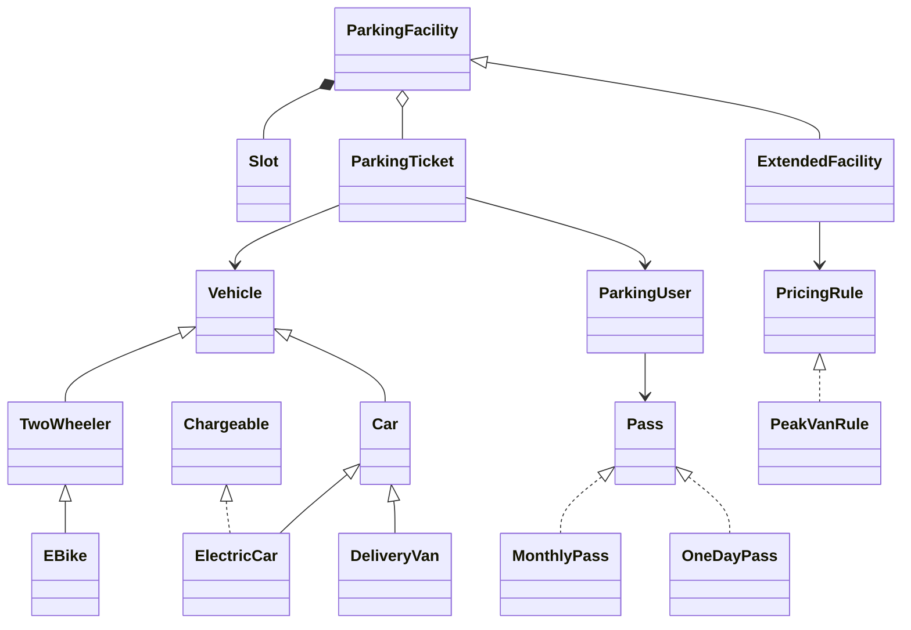

# Class diagram
Solid hollow triangle: extends. Dashed hollow triangle: implements. Filled diamond: facility owns its slots. Tickets reference one user and vehicle.

The DOT and SVG files show the original baseline; this Mermaid includes the Task12 additions. No production source under Task01 is changed for Task12.
